* Catalist
A menu-driven anime and manga tracker for the console, written in *C++23*.
Run it, choose a number, and press =0= to exit.

Your lists live in one file, =catalist.csv=, in the Catalist project
folder. Catalist goes online only to add a title, which it finds through the
public API of [[https://anilist.co][AniList]]; no account is needed. Lists
move in and out as MyAnimeList XML, which AniList and MyAnimeList both read.

** Build and run
You need GCC 13 or later, CMake 3.20 or later, and Ninja or Make. =curl= is
used at run time to reach AniList. doctest is needed for the tests
(=-DBUILD_TESTING=OFF= builds without them). Every screen is plain ASCII, so
any terminal and font will do.

#+begin_src sh
cmake -B build -DCMAKE_BUILD_TYPE=Release
cmake --build build -j$(nproc)
./build/catalist
ctest --test-dir build --output-on-failure
#+end_src

The program is built in =build/=. It always uses =catalist.csv= in the project
folder, wherever you run it from, and git ignores that file. A copy installed
elsewhere, such as with Nix, uses =catalist.csv= in the folder you run it from.
On Nix, run =nix develop= first to get the compiler and tools.

** The menu
Catalist opens on the main menu. A terminal at least 106 columns wide shows
the big logo.

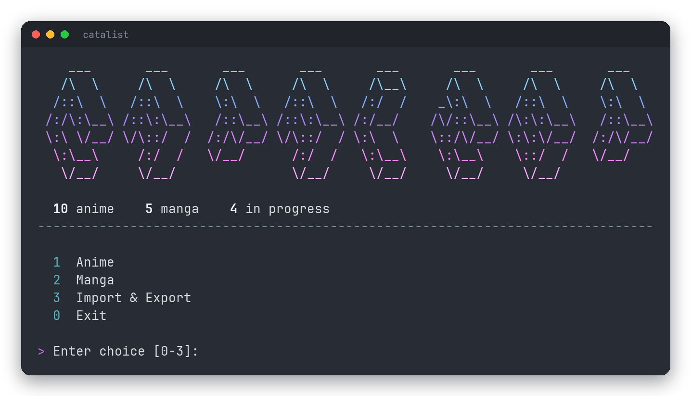

*** Anime and Manga
Each list is numbered, 20 a page, latest change first. Under it is a
numbered menu: 1 Open a Title (then type its number), 2 Search, 3 Filter,
4 Sort, 5 Clear Search/Filter, 6 Add from AniList, 7 Stats, 8 Next Page,
9 Previous Page and 0 Back.

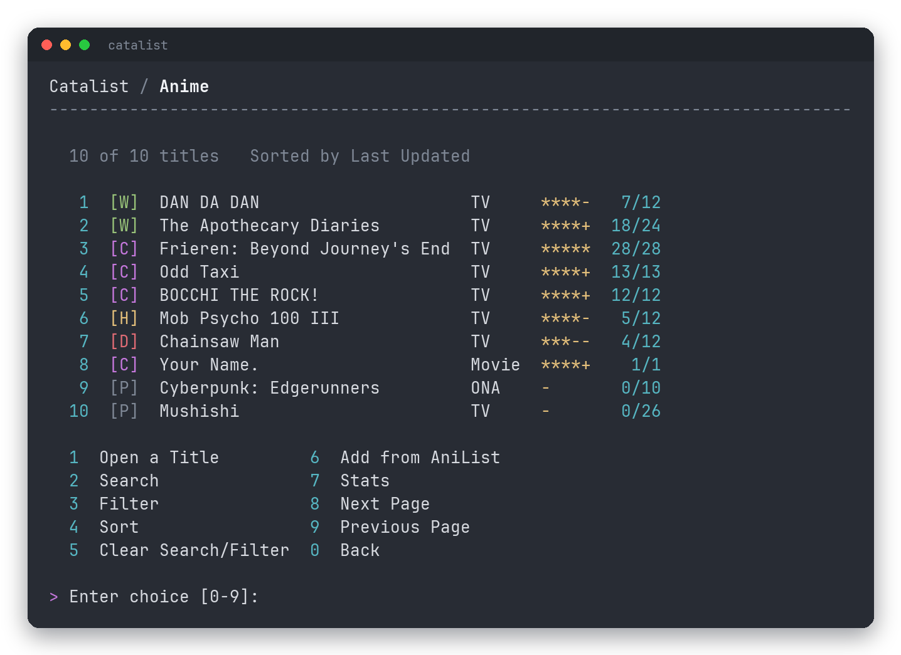

2 Search keeps the titles that hold every word typed.

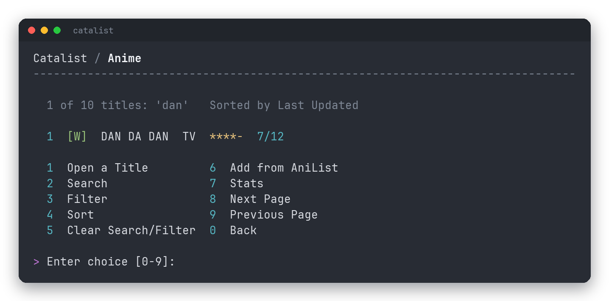

3 Filter narrows by status, score or (for anime) format. 4 Sort orders by
last updated, title, status, score, progress or start date, or reverses.

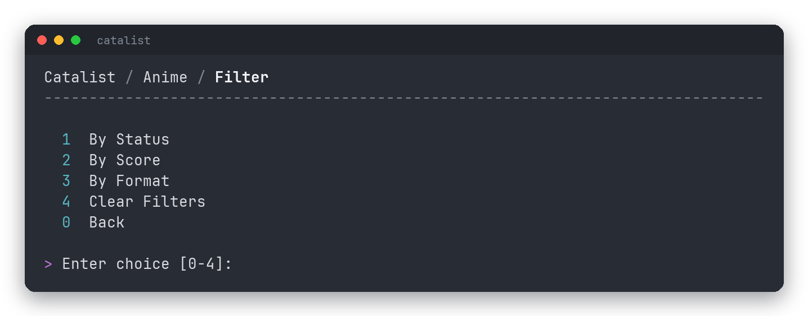

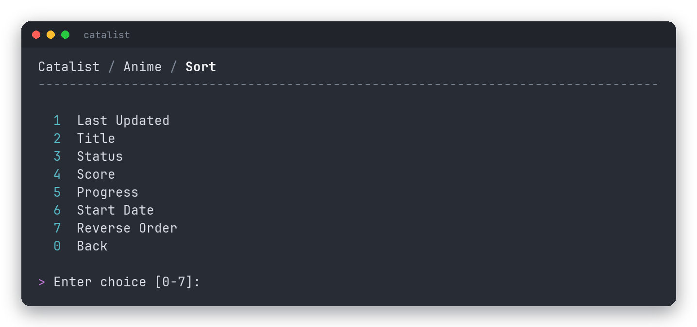

7 Stats counts the list.

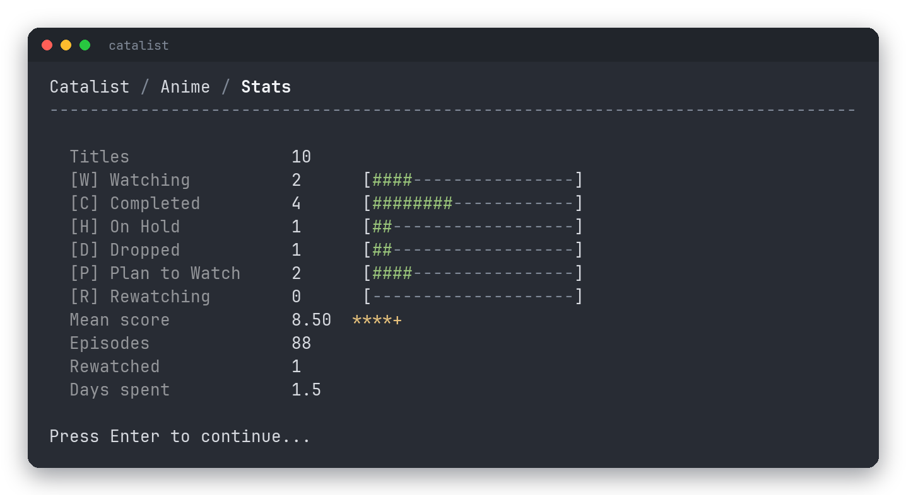

6 Add from AniList searches AniList for that kind of title, then asks for its
status.

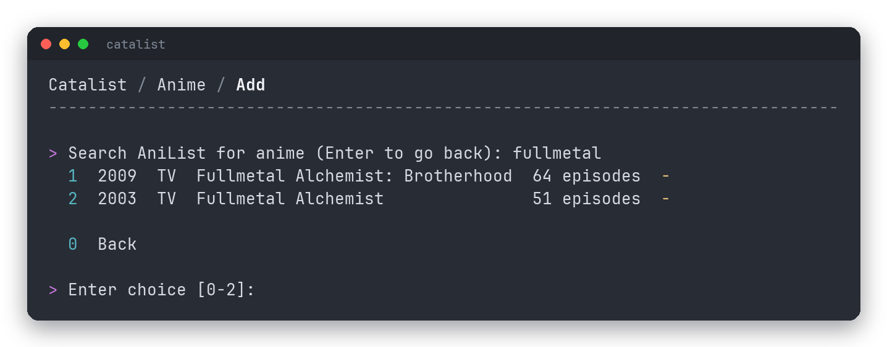

The Manga list works the same way, counting chapters and volumes.

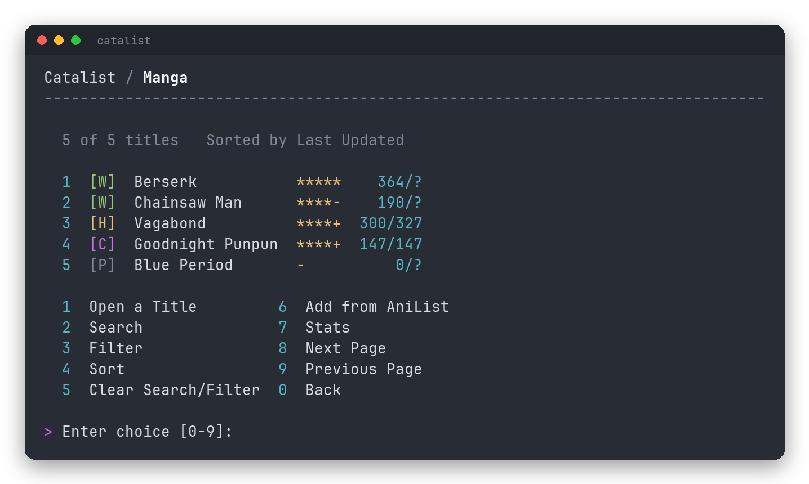

*** A title's page
Its card, then +1 Episode (or Chapter), Set Progress, Set Status, Set Score,
Edit Details and Remove, which asks first.

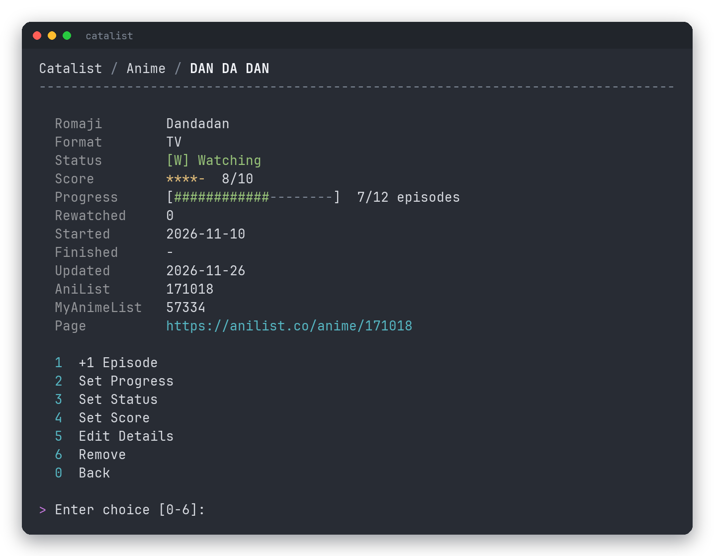

Edit Details holds the changes made less often: the total, volumes read for
manga, the start and finish dates, and the name.

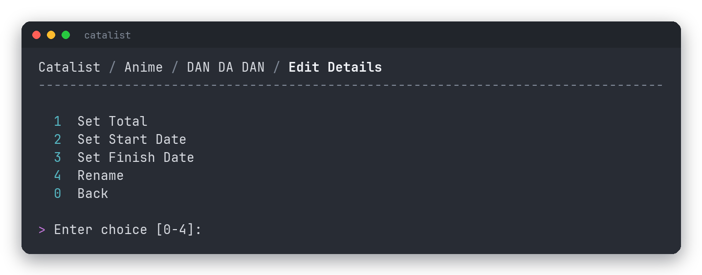

*** Import & Export
Import Anime XML, Import Manga XML, Export Anime XML and Export Manga XML, all
in MyAnimeList's format. Unpack =.xml.gz= files with =gunzip= first. Where an
import differs from your list, you choose title by title.

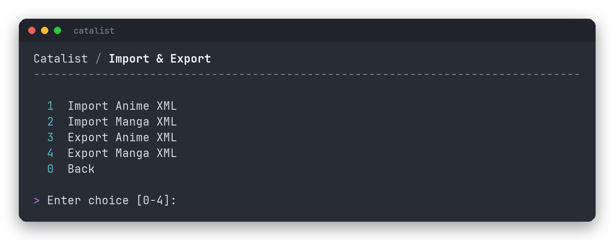

Each asks for a file path and shows how one is read: a name alone is in the
folder Catalist runs in, =~= is your home folder, and a full path works too.

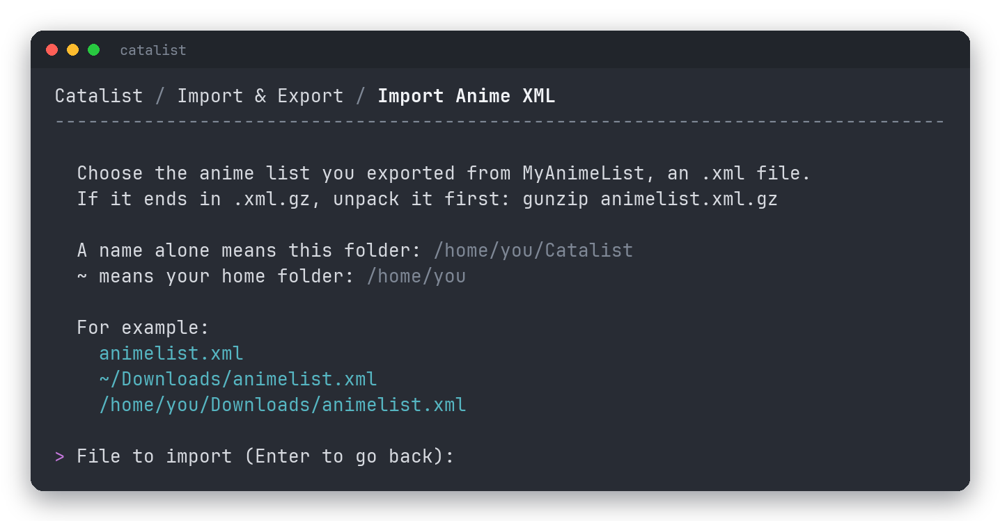

*** Marks and search
Statuses are shown as =[W]= Watching or Reading, =[C]= Completed, =[H]= On
Hold, =[D]= Dropped, =[P]= Planned and =[R]= Rewatching or Rereading. A score
is five stars, =*= full, =+= half and =-= empty. An anime's format (TV, Movie,
OVA and so on) comes from AniList or the XML.

To find a title, choose 2 Search and type any part of its English or romaji
name. The words can be
in any order, and capitals and punctuation do not matter.

** Data and backups
*To back up, copy =catalist.csv=.* Each save writes the whole file to
=catalist.csv.tmp= and renames it, so a crash cannot leave half a file. If the
file is damaged, Catalist says which row and stops without changing it.

** Source layout
#+begin_example
src/main.cpp      starts the program
src/system.*      files, curl, the clock and the terminal
src/core/         a title and its rules, dates, results, UTF-8 text
src/storage/      the lists in CSV, and MyAnimeList XML
src/web/          AniList, and the JSON it answers in
src/menu/         the menus and their screens
tests/            unit tests, one folder per source folder, and a smoke test
#+end_example

=DECISIONS.org= records every decision with the code behind it. See
[[file:CHANGELOG.org][CHANGELOG.org]] for release notes.

** License
MIT
